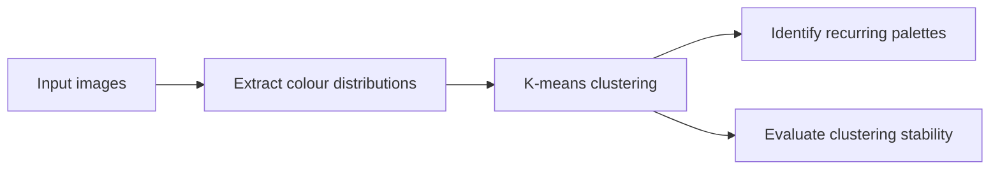

# Colour Clustering Pipeline

Python / Scikit-learn project by Mahdi Alam · September–December 2023.

> **Repository status:** Documentation only. The original pipeline code, input images, configuration, and evaluation outputs are not included. This repository documents the project described in Mahdi's resume.

## Overview

A pipeline for extracting dominant colour distributions and identifying recurring palettes with **K-means clustering**. The project also evaluated clustering stability.

## Workflow

This diagram is a conceptual summary, not a verified description of the original module structure.

## Engineering focus

- Python-based data processing
- Scikit-learn clustering
- Connecting visual patterns to quantitative evaluation
- Assessing whether clustering outcomes are stable

## Evaluation status

The resume does not specify the image dataset, colour space, number of clusters, stability metric, random seeds, or numerical results. These details remain undocumented here rather than being inferred.

## What would complete this repository

- Original source code and dependency environment
- Input image source and usage permissions
- Colour-space and preprocessing choices
- Cluster-selection and stability-evaluation protocol
- Example palettes, run instructions, and reproducible outputs

## Contact

[Mahdi Alam on GitHub](https://github.com/mahdi-alam360) · [LinkedIn](https://www.linkedin.com/in/mahdi-alam-264127150/)
